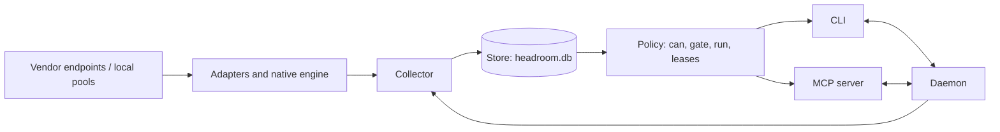

# Design overview

For contributors. User-facing behaviour is in [README.md](README.md) and [docs/](docs/); this file is the map of the code.

## What is read, and how

- **Adapters** (`src/adapters/`): native TypeScript readers for Claude, Codex, Kimi, Grok and Antigravity (failure and no-daemon cases). Vendor credentials are read at call time from the vendor's own store or file and are not copied.
- **Native engine** (`engine/`, `src/engine/native/`): a bundled macOS reader, used for Antigravity, run through `src/engine/native/run.ts`. It is not used on Windows (`src/collector.ts`).
- **Local pools** (`src/engine/local.ts`): vLLM and llama.cpp servers.
- **Collector** (`src/collector.ts`): polls every account and turns the results into `Observation` rows (`src/types.ts`, `src/engine/observation.ts`).
- **Store** (`src/store.ts`): SQLite (`node:sqlite`), file `headroom.db` in the Headroom home. Holds observations, leases, events and spend.
- **Daemon** (`src/daemon.ts`): long-running poller that serves requests over a local socket (a named pipe on Windows).
- **Front ends**: the CLI (`src/cli.ts`) and the MCP server (`src/mcp.ts`). Both fall back to a direct read when no daemon answers.

## Data flow

## Principles

Each is enforced in code and pinned by a test; see "Design principles" in the README for the file-level list.

- **Fail closed.** A missing, stale, failed or inconsistent reading is UNKNOWN, and `can` answers NO for it unless `--allow-unknown` is passed (`src/policy.ts`, `test/store-policy.test.ts`).
- **The JSON contract is additive-only.** Within 1.x fields are added, never renamed or removed, and enumerations only grow. `test/json-contract.test.ts` snapshots every output's field shape ([docs/json-contract.md](docs/json-contract.md), `src/json-contract.ts`).
- **Local only, no telemetry.** The one network call that is not a vendor read is an opt-out update check (`update_check = false` in `policy.toml`; [SECURITY.md](SECURITY.md)).
- **Process hygiene.** Headroom signals a process only if its recorded pid, command and start time still match (`src/process-tree.ts`, `src/agy-watchdog.ts`). These checks are not active on Windows.
- **Secrets stay in their own stores.** Output and logs are redacted (`src/security.ts`).

## Where to start reading

1. `src/types.ts`: the `Observation`, `Lease` and event types everything shares.
2. `src/policy.ts` and `src/orchestrator-reads.ts`: how `can`, `gate`, `route` and `plan` decide.
3. `src/collector.ts`, then one adapter such as `src/adapters/codex.ts`.
4. `src/store.ts` and `src/migrations.ts`: persistence and schema versions.
5. `src/mcp.ts` and `src/cli.ts`: the two front ends. Tests are in `test/`; redacted vendor fixtures are in `test/fixtures/`.
